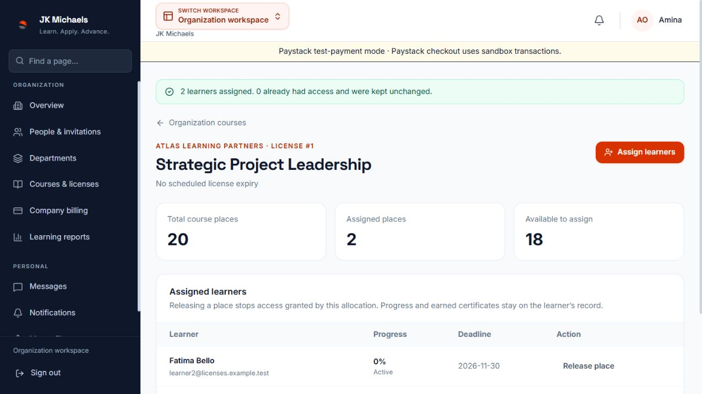
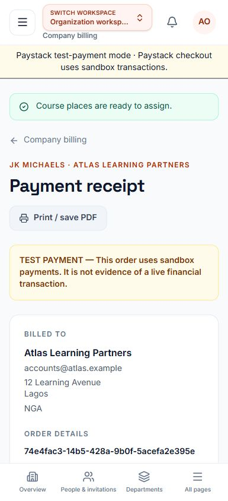

# Organization courses, licenses and billing

This change connects organization membership to course access. An organization administrator can buy course places or use a platform-admin allocation, assign current members or a department, set a completion deadline and release assignments. Organization membership seats remain separate from course-license quantities.

**Deployed to production on 5 October 2026 at 16:12 WAT (15:12 UTC)** in release `20261005-licenses`.

## How to use it

1. Platform administrator: open **Administration → Organizations → Manage organization → Manage course allocations**. Search for a published course, allocate places, record an agreement/reason and optionally set an access-expiry date.
2. Organization administrator: open **Organization workspace → Courses & licenses**. Alternatively, use **Buy course places**, select a course and quantity, and complete the company checkout. Verified payment makes the places available; creating a pending order alone grants no access.
3. Open the license's **Manage learners → Assign learners**. Select members or a department and optionally set a completion deadline. Members must be active learners in that organization and satisfy course prerequisites. A department request includes current eligible members only, up to 1,000 learners per request.
4. Learners use **My learning**. Their ordinary lesson, assessment, progress and certificate workflows apply. The organization administrator sees results under **Learning reports** and can release a place from its license's learner list.
5. **Company billing** lists company orders separately from personal purchases. It provides payment status/recovery, company details captured at purchase time, item quantities and printable receipts. Paystack test transactions are explicitly labelled.

A company with 100 membership seats and 30 places on a course can assign that course to 30 members. Completed learners retain their place until it is explicitly released. A completion deadline is a reporting target; license expiry and enrollment access status control access.

## Implementation contract

- Licenses belong to exactly one organization and course. A verified company order creates a separate, replay-safe license for each purchased course line. Platform administrators may also grant a license explicitly with a reason and optional expiry.
- A license place is occupied until its assignment is explicitly released, including after completion or member deactivation. Release retains progress and earned credentials. Department assignment takes the current active learner membership as a snapshot; future department members are not silently enrolled.
- Assignment checks active organization, actor, current membership, publication, prerequisites, available places and existing enrollment restrictions. Existing independent access is preserved without consuming another place. Repeated requests do not duplicate enrollment or reset progress/deadlines. Company administrators cannot override a suspended or expired enrollment.
- License access is rechecked for lessons, resources and offline progress through the existing shared enrollment guard. Revocation, expiry, refunded purchase, released assignment or departure from the organization removes license-derived access. Independent grants remain independent.
- Company checkout uses explicit organization scope, server prices and bounded quantities. It does not enroll the purchaser. Company name, contact email and address are snapshotted on the order. Company administrators can view, resume and reconcile company orders; ordinary members and administrators of another organization cannot.
- Bulk pricing is published unit price multiplied by quantity, with existing eligible coupon rules. No automatic volume discount, tax amount, recurring renewal or invoice payment terms are invented. Billing presents printable order summaries and verified payment receipts.
- Paid course enrollment opens the existing product checkout. If a published course has no product, a server-generated product uses the course's configured price; deliberately inactive products are not reactivated.
- Production payment mode stays TEST. No live charges, messaging or destructive data resets are part of this implementation.

## Validation and release

- Full suite: **196 tests / 1,669 assertions** passed on SQLite and on isolated MariaDB `jk_licenses_test`. SQL tests use a separately named database to avoid colliding with other agents' validation. Thirteen new license tests cover the new behavior in addition to existing commerce and tenant tests.
- A real MariaDB concurrency exercise launched two independent assignment processes against one available place. Exactly one succeeded; the other was rejected, and only one place was consumed.
- Paystack's real **test** API initialized an organization checkout for two NGN 50 places. The order remained pending, with zero licenses and zero purchaser enrollments. No charge was submitted. Paid fulfillment, exact-amount verification, mismatch rejection, duplicate settlement, refund access removal and recovery were verified through deterministic provider-response tests. This is not a new end-to-end live payment or recurring-billing acceptance claim.
- Vite build passed: **2,840 modules / 29.22 seconds**. All **957 deployed runtime files** were hash-verified; seven changed frontend assets were fetched over HTTPS and compared with the release artifact.
- Populated browser preview verified department assignment, deadlines, available-place counts, a zero-value five-place company order and receipt, and a twelve-place platform-admin allocation. Desktop and 390 px mobile receipt checks passed without horizontal document overflow. Temporary viewport sizing was reset. A cross-port localhost preview-cookie collision was resolved by using a separate local hostname; it did not affect production.
- Production read-only rendering returned 200 for allocations on all three existing organizations, the organization course list, company catalog and billing. All **13 new routes** were checked for authentication and the appropriate platform-admin or organization-admin restriction. No production accounts or orders were created for these checks.
- Additive migration `2026_10_05_150000_add_organization_course_licenses` applied successfully. Existing data was preserved: **3 organizations, 29 users, 130 enrollments, 0 CRM contacts/import batches, 0 orders/payments/certificates** at cutover. New license and assignment tables started empty. Earlier orders default to individual scope rather than becoming visible to company administrators.
- All **28 production operational checks passed**. Queue and contact-import workers, scheduler and health monitoring are active. Payment mode remains **TEST**. Existing SMTP configuration, application keys and shared storage were preserved.

Machine-readable evidence: [deployment, SQL concurrency, provider and production checks](organization-course-licenses-2026-10-05.json).

## Recovery

The protected backup is `/root/jkm-licenses-20261005/backup-151148`. The release archive SHA-256 is `1c8b0123fe226dd870d80559a36ee618a8baaf834e911fe4496eda3571ddb9aa`.

The prior release remains at `/var/www/vhosts/jkmichaelspm.com/.jkm-releases/20261005-organizations`. For rollback after licenses have been used, use the prepared compatible release `/var/www/vhosts/jkmichaelspm.com/.jkm-releases/20261005-organizations-license-rollback`: it adds a guard that denies access derived from the new license field while retaining independent enrollments. Rolling back directly to older code would omit that access check. Take a fresh backup, pause the application workers and scheduler, switch the release pointer, reload this domain's PHP pool, reopen and rerun operational checks. Keep the additive schema and current business data; do not drop license history or restore an old database over newer writes.

This closes organization course allocations, bulk course licenses, company purchase/billing screens and paid-course checkout routing. Broader enterprise audit items, organization SSO and independent Contabo backup verification retain their existing status. Company purchases here are one-time course licenses; automatic volume-discount schedules, recurring company contracts, tax calculations and credit terms are not asserted.

## Interface evidence

These are synthetic local previews of the same interface deployed to production.

