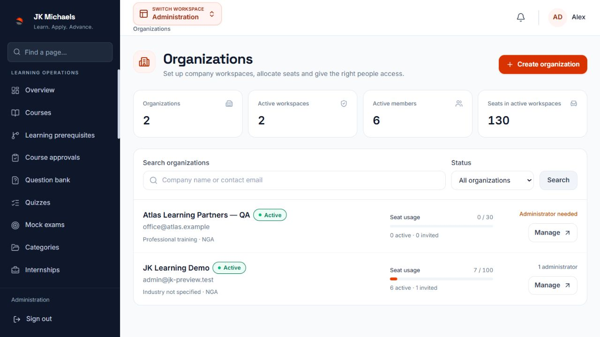
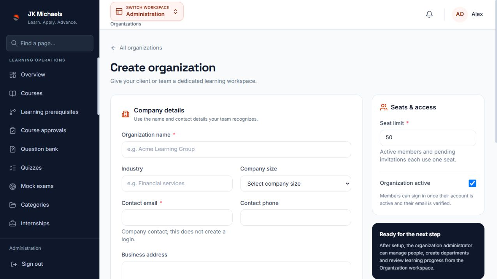

# Organization management — implementation and production release

The platform administrator can now create and manage learning organizations at **Administration → People & business → Organizations** or https://app.jkmichaelspm.com/admin/organizations. The module was deployed in release `20261005-organizations` and verified at **14:26 UTC on 5 October 2026**.

## User workflow

1. Select **Create organization**.
2. Enter the company name and contact email. Add industry, company size, phone, business address and a three-letter country code as appropriate.
3. Set the seat limit and active status.
4. Assign an eligible existing user, create a new administrator account, or choose to assign an administrator later.
5. Save. The manage page shows existing administrators, seat usage and a link to the organization's users. The organization administrator uses the separate Organization workspace for people, departments and learning reports.

The company contact email does not automatically create a user account. New administrator accounts require an individual password of 12–72 characters with letters and numbers, and email verification before accessing the workspace. Saving the organization sends no email. Existing user passwords and other roles are preserved when adding the organization administrator role.

The directory supports company/contact search, active/inactive filters, pagination, seat usage and missing-administrator indicators. The responsive form includes labels, validation messages, explicit access consequences and loading states. Users & access now exposes an organization filter and preserves it while searching.

## Boundaries and implementation

- Six routes are restricted to authenticated **platform administrators**, including the rate-limited candidate search. Organization administrators and other roles cannot manage platform organizations.
- Administrator assignment accepts active members of the target organization or eligible unassigned accounts. It rejects platform administrators, inactive/deleted users and members of a different organization. Search results are bounded to 20 and marked private/no-store.
- Company creation and administrator creation/assignment occur in one transaction. A failed assignment leaves no partial company or new account. Duplicate administrator emails are rejected by validation and the existing database constraint.
- Seat changes lock the organization row and count active members plus unexpired pending invitations. Limits cannot be reduced below committed seats. A new administrator consumes a seat; promoting a current member does not consume a second seat.
- Deactivation preserves company/member records and roles while revoking member sessions, API tokens and push subscriptions. Platform administrators retain their platform access. Reactivation restores the organization access boundary without silently changing member account status.
- Creation, changes and administrator assignments produce audit records. New administrator passwords are hashed, excluded from audit payloads and not flashed into validation sessions. Custom password fields are excluded from automatic whitespace trimming.
- Slugs and UUIDs are generated server-side; the UI does not accept arbitrary role, billing, settings or ownership fields. Existing subscription settings are preserved. This module does not initiate billing or provision course entitlements.

Main implementation: `app/Http/Controllers/Admin/OrganizationController.php`, `resources/js/Pages/Admin/Organizations/{Index,Form}.vue`, `resources/js/navigation/workspaces.js`, `routes/web.php` and `bootstrap/app.php`. The existing organization, membership and seat models are reused; **no schema migration was required**.

## Validation and deployment

- **15 tests / 199 assertions** passed on SQLite, covering the new module and existing organization workflows.
- The frozen deployment snapshot passed the **full 183-test / 1,515-assertion suite on isolated MariaDB**. Tests did not connect to the production database or send email.
- The Vite production build passed. Source was frozen and checked against the deployed baseline so concurrent unrelated edits were excluded.
- Browser checks used a synthetic company only in the local preview: create, edit, persisted seat limit, excluded ineligible candidate, administrator form fields and desktop/mobile layout. No browser console warnings or errors were reported. Temporary viewport sizing was reset.
- On production, guest organization routes require sign-in, the new assets were fetched and hash-compared, and all **933 runtime archive files** match the reviewed artifact. Prior immutable assets remain available for clients transitioning from the previous release.
- Read-only production controller rendering returned 200 for directory, create, all three existing organization edit pages and candidate search. Route inspection confirmed the platform-administrator middleware on every endpoint. The production administrator remains `admin@jkmichaelspm.com`; email verification was observed as complete without changing it in this task.
- All **28 live operational checks passed**; queue/import workers, scheduler and health monitor are active. Paystack remains **TEST**.
- Production counts were preserved through cutover: 3 organizations, 29 users, 130 course enrollments, 0 CRM contacts and 0 contact import batches. The local QA organization is absent from production.

Release archive SHA-256: `cc9f3b4152edea948d1e43405a37a45c3cb38f7453428cfaf3833ab4b985290a`.

Protected server records are under `/root/jkm-organizations-20261005`. The final backup is `/root/jkm-organizations-20261005/backup-142609`, containing the SQL database and runtime storage/environment. The previous release remains `/var/www/vhosts/jkmichaelspm.com/.jkm-releases/20261005T125643Z`. The first attempt was rolled back because of a verification-script HTTP helper error; the corrected retry passed. With an unchanged schema, a guarded code-only rollback retains the current database and shared storage rather than restoring old business data. Stop workers/scheduling and take a fresh backup before any future rollback.

Machine-readable evidence: [organization management verification](organization-management-2026-10-05.json).

## Interface evidence

These screenshots show the tested local preview with synthetic data; the same frozen interface assets were deployed to production.

The module closes the missing platform organization-creation interface. Broader enterprise acceptance items, deferred SSO and independent Contabo verification remain governed by the main audit.
