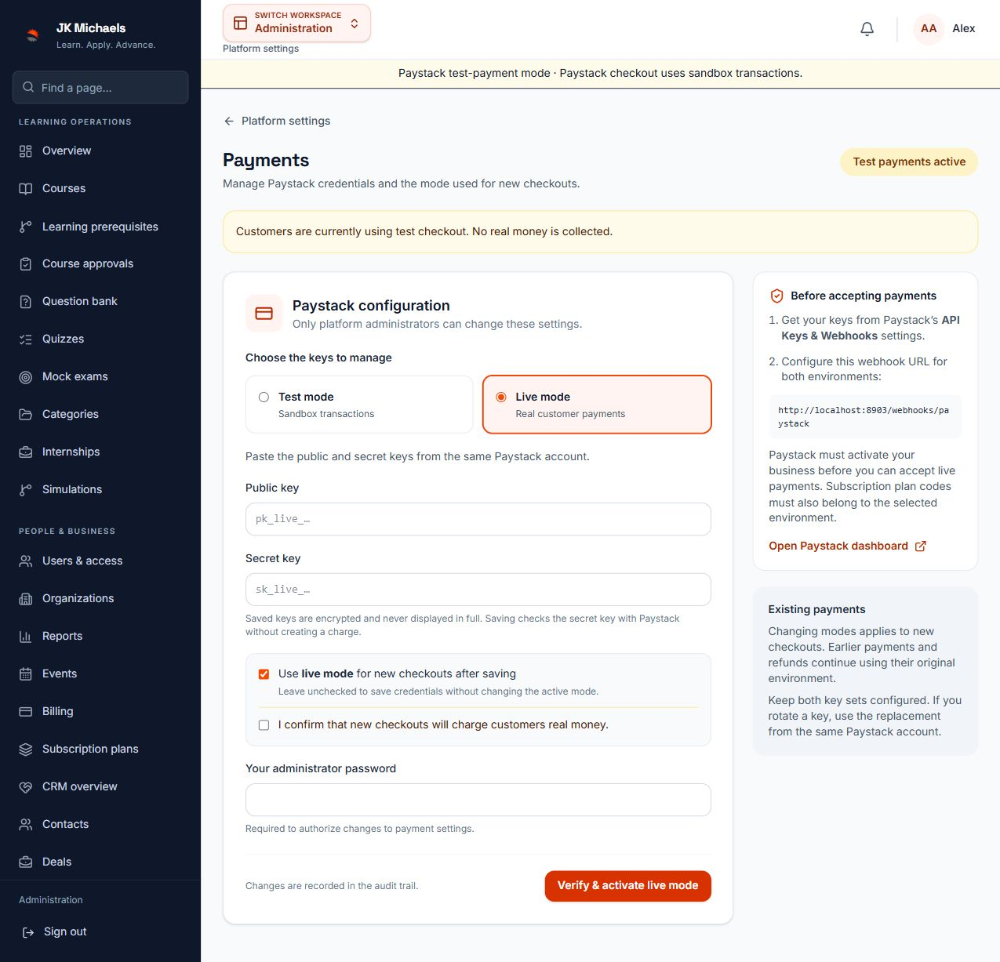

# Paystack settings in platform administration

Implementation date: 5 October 2026. Scope: administrator-managed Paystack credentials and explicit test/live activation. This change does not itself activate live billing.

## Administrator instructions

Open **Administration → Platform settings → Payments**, or `/admin/settings/payments`. Only an active platform administrator can access this page.

1. Choose **Live mode** to manage live credentials (selecting it alone does not change checkout).
2. Enter the public `pk_live_…` and secret `sk_live_…` keys from the same Paystack account. Both must be entered when replacing credentials. Leave both blank to retain an already configured pair.
3. To activate, select **Use live mode for new checkouts after saving** and confirm that customers will be charged real money. Leave this unchecked to save keys ahead of activation.
4. Enter your administrator password and select **Verify & activate live mode**, or **Verify & save keys**.
5. Confirm the page's active-mode badge. To return to test mode, select Test mode, activate it using saved test credentials, and confirm with your password.

Configure `https://app.jkmichaelspm.com/webhooks/paystack` in the Paystack dashboard for both environments. Existing subscription plan codes must belong to the environment used for new subscription checkouts. Public keys are checked for format and environment; the secret is checked with Paystack's authenticated, read-only balance endpoint. This does not prove public/secret account pairing or merchant go-live eligibility and does not create a charge. The checkout implementation uses the secret key server-side.

## Storage and security

- Dedicated `payment_gateway_settings` record, separate from the general platform-settings payload. The credential map uses Laravel's `encrypted:array` cast and the model hides it from serialization. Preserve the existing application encryption key and protected database backups.
- Admin data includes configuration flags, mode, optimistic version and the final four characters of each key; full saved keys are never returned to the page.
- Credential updates require an active platform administrator, authenticated web session, CSRF validation, current password and a 5/minute route throttle. Live activation needs an explicit confirmation.
- Incorrect credentials, provider failures and stale administrator versions leave settings unchanged. Credentials/passwords are excluded from session old-input flashing. Audit events record mode/profile changes and verification result, without credentials.
- Until the first admin update, existing environment variables remain the credential fallback. The first save preserves the other environment's configured keys. Subsequent changes are read dynamically by HTTP requests, console commands and existing service objects, without a config-cache rebuild or worker restart.
- The mode is saved against payments, legacy Paystack transactions, subscription checkouts, subscriptions and billing webhook events. Existing records are backfilled with the deployment environment. This production migration assumes historical records were created in the existing test environment; a mixed-mode installation needs per-record reconciliation before applying this migration.
- Verification, refunds, recurring subscription reconciliation and cancellation select the original environment's credentials. Webhook signatures are checked against the retained test/live secrets, and signed test events cannot settle a live payment. Provider domain mismatches are rejected. Pending checkout links from a previous mode cannot be resumed by the application; their payment status can still be reconciled. Already-issued provider URLs are not remotely canceled by a mode switch.
- Existing test orders/access grants are retained, not silently converted into paid live transactions or erased. Rotate keys only within the same Paystack account to preserve historical reconciliation.

## Verification

- Local full suite: **202 tests, 1,749 assertions passed**. After the final domain-check and monitoring adjustments, the relevant 35-test commerce/settings suite passed with 359 assertions.
- New settings tests cover role/inactive-account denial, password verification, key environment mismatch, explicit live confirmation, encrypted storage, redacted page/audit/session data, save-without-activation, activation of saved keys, provider rejection, optimistic conflicts, dynamic service credentials, historic mode verification, cross-mode webhook rejection and old-checkout resume rejection.
- Vite build passed (34.81 seconds).
- Browser preview: navigation from Platform settings, active test badge independent of live-profile selection, conditional real-money confirmation, masked/empty credential inputs; desktop and 390px mobile screenshots. Document width 385px in a 390px viewport; no horizontal overflow. Synthetic preview only, no real keys entered through the browser.
- Production deployed at **16:38 WAT**, release `20261005-payments`. Isolated MariaDB: **202 tests / 1,749 assertions passed**. All 28 production operational checks passed; 963 runtime files and 3 changed asset responses verified. Queue/contact-import workers and scheduler/health timers active. Production page rendering succeeded with secrets absent from its payload; platform-admin route guards and update throttling verified. Existing test credentials passed a real, read-only Paystack `GET /balance` request (HTTP 200). No settings or payment mutation was submitted in production: mode remains test, settings version 0. Database counts preserved. Full results: `paystack-admin-settings-2026-10-05.json`.

## Operational handling

The release adds one settings table and nullable payment-mode columns. Keep this additive schema and current business data during recovery. Reverting to the prior environment-only runtime is safe only while settings version is zero. After an administrator changes settings, use a compatible forward fix; do not silently revert to old environment credentials. The deployment script refuses that unsafe rollback.

The operational payment check now reads the effective administrator settings. Its explicit `--allow-test-payments` allowance accepts test or live keys and still reports sandbox operation; the default release gate requires live keys. This does not replace provider settlement evidence or the broader enterprise release gates.

## References

[Paystack authentication and key environments](https://paystack.com/docs/api/authentication/), [read-only balance API](https://paystack.com/docs/api/transfer-control/), [webhook signatures](https://paystack.com/docs/payments/webhooks/).

